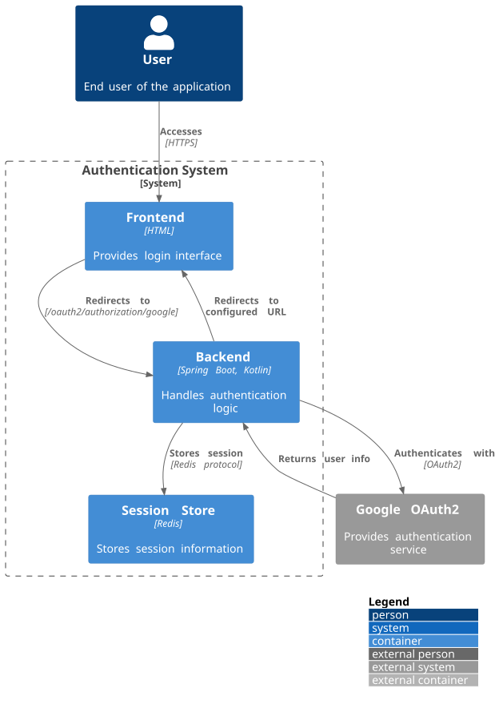

# Authentication Service

[](https://github.com/ktenman/auth/actions/workflows/ci.yml)

## Overview

This authentication service is a Spring Boot application written in Kotlin that signs users in with Google. It works
as a forward-auth gate: a reverse proxy asks it whether each request comes from a signed-in user.



## Features

- OAuth2 authentication with Google
- Session management using Redis
- Configurable allowed email addresses
- Session validation endpoint for a reverse proxy
- Return to the requested page after signing in
- Logout with a plain form post

## Technologies Used

- Kotlin 2.4
- Spring Boot 4.1
- Spring Security
- Redis for session storage
- GraalVM native image (about 25 MiB of memory in use)
- Docker for containerization

## Prerequisites

- JDK 25
- Docker and Docker Compose
- Redis
- Google OAuth2 credentials (Client ID and Client Secret)

## Configuration

The application uses environment variables for configuration. Make sure to set the following variables:

- `GOOGLE_CLIENT_ID`: Your Google OAuth2 client ID
- `GOOGLE_CLIENT_SECRET`: Your Google OAuth2 client secret
- `REDIRECT_URI`: The site a signed-in user is sent to, for example `https://example.com`
- `ALLOWED_EMAILS`: Comma-separated list of email addresses allowed to authenticate

Google sends users back to `/login/oauth2/code/google`. Add that address to the client's authorized redirect URIs in
the Google Cloud console, for example `https://example.com/login/oauth2/code/google`, or
`http://localhost:8083/login/oauth2/code/google` for a local run.

## Running the Application

1. Set up the environment variables mentioned above.
2. Run the application using Gradle. It starts Redis from `compose.yaml` with Docker Compose by itself:
   ```bash
   ./gradlew bootRun
   ```

The application will start on port 8083 by default.

## API Endpoints

* `/login`: Login page. Its `redirect` parameter is the page to return to after signing in
* `/oauth2/authorization/google`: Initiates Google OAuth2 authentication
* `/login/oauth2/code/google`: Where Google sends the user back
* `/validate`: Validates the current session. Answers 200 with the user's email in the `X-User-Id` header, or 401 if
  that email is no longer allowed
* `/user`: Returns the signed-in user's email, name and picture as JSON
* `POST /logout`: Logs out the current user and redirects to `/`
* `/`, `/home`: A page that confirms the sign-in
* `/actuator/health`: Health check, which also pings Redis

Everything except the login, OAuth2, logout and health paths redirects to `/login` without a session.

## Protecting an Application

A reverse proxy in front of the application asks `/validate` before it lets a request through:

1. With a session, `/validate` answers 200 and the proxy forwards the request, with the user's email in `X-User-Id`.
2. Without one, it redirects to `/login?redirect=<page>`.
3. After the Google sign-in the user lands on `REDIRECT_URI` + that page.

For that the proxy has to:

- send `/validate` the visitor's cookies and the requested page in `X-Forwarded-Uri`
- serve the login, OAuth2 and logout paths on the application's own domain, so the session cookie comes with every
  request to it
- drop `X-User-Id` from incoming requests, so a route that skips `/validate` can't be handed a forged one

With Caddy, where `auth` is this service and `app` is the application behind it:

```caddyfile
example.com {
    request_header -X-User-Id

    @auth path /login /login/* /oauth2/* /logout
    handle @auth {
        reverse_proxy auth:8083
    }

    handle {
        forward_auth auth:8083 {
            uri /validate
            copy_headers X-User-Id
        }
        reverse_proxy app:8080
    }
}
```

## Security Considerations

- Only configured email addresses are let through: the list is checked at sign-in and again on every `/validate`
- Sessions are stored in Redis for 30 days
- The `AUTHSESSION` session cookie is `Secure` with `SameSite=None`
- CSRF protection is enabled, except on `/logout`, where a cross-site POST can only sign the user out
- The page to return to after signing in must be a path on the `REDIRECT_URI` site. Anything else lands on
  `REDIRECT_URI` itself

## Development

To set up the development environment:

1. Clone the repository
2. Import the project into your IDE as a Gradle project
3. Ensure you have the required environment variables set
4. Run the AuthApplication.kt file to start the application

## Testing

Run the tests using:
```bash
./gradlew test
```

`bench/run.sh` signs in against a stand-in for Google, checks the session, page and logout paths, then prints the
container's memory use. CI runs it against each native image before pushing it.

## Docker

CI publishes the image built from `main` to Docker Hub as `ktenman/auth:latest`, for amd64 and arm64.

The application includes a Dockerfile for easy containerization. To build and run the Docker image yourself:

1. Build the Docker image (compiling the native image takes a few minutes and about 6 GB of memory):
   ```bash
   docker build -t auth-service .
   ```
   If the native image fails with a missing serialization or reflection registration for a type, add that type to
   `src/main/resources/META-INF/native-image/auth/reachability-metadata.json`.

2. Run the Docker container:
   ```bash
   docker run -p 8083:8083 -e GOOGLE_CLIENT_ID=your_client_id -e GOOGLE_CLIENT_SECRET=your_client_secret -e REDIRECT_URI=your_redirect_uri -e ALLOWED_EMAILS=allowed@email.com auth-service
   ```
   The container expects Redis at the host name `redis`; set `SPRING_DATA_REDIS_HOST` to use another one.
   Set `JAVA_OPTS` to override the default `-Xmx128m -Xmn8m -Duser.timezone=Europe/Tallinn`.
